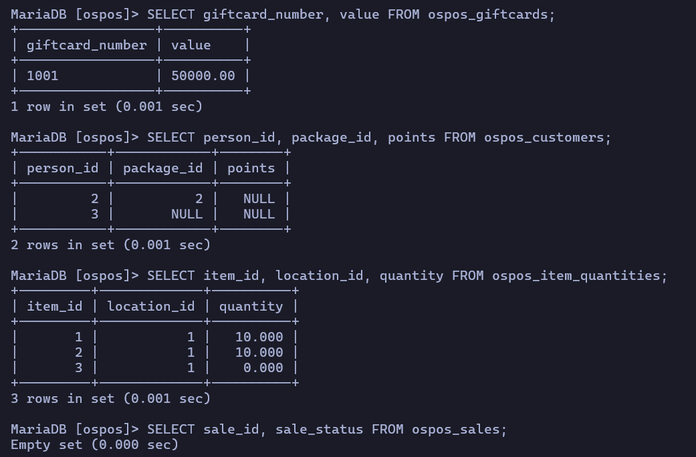
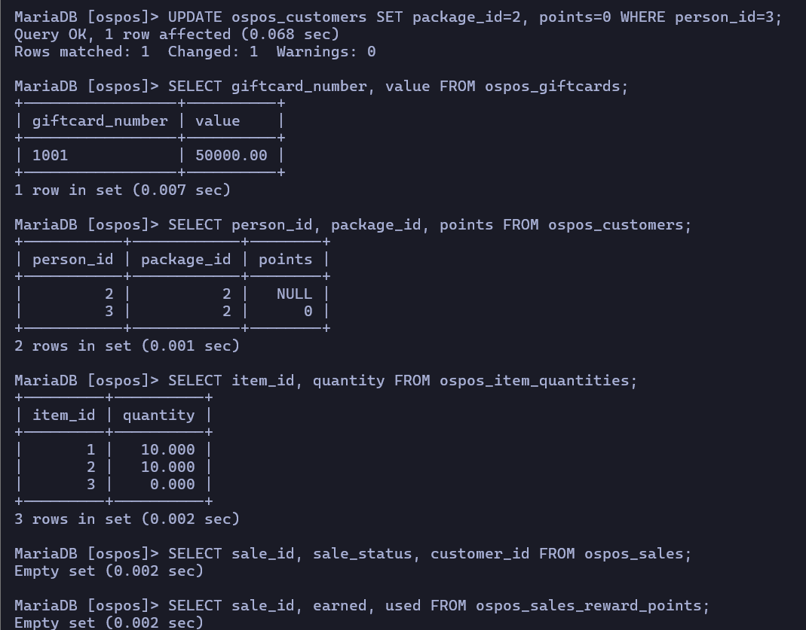

# 결함 1 발견. 신규 고객의 포인트가 NULL이라 적립이 조용히 실패함 (NULL처리가 되지 않아 포인트 계산이 되지 않는 문제 발생)

- 등급: P0
- 제보: OSPOS 저장소 새 이슈 (원문은 문서 하단)
- 버전: OSPOS 3.4.4-dev, commit `9253cfe8`

## 요약

고객 메뉴에서 만든 고객의 포인트가 0이 아닌 NULL로 저장된다.
문제는 이 고객이 결제해도 포인트가 쌓이지 않는다는 점이다.
NULL은 값이 없는 수기에, 어떤 수를 더해도 계산이 되지 않고, 결과가 NULL이 된다.
(예: 0+8=8이지만 NULL+8=NULL이다.)

그런데도 겉으로는 아무 문제가 없어 보인다.
판매는 정상적으로 완료되고, 적립 이력에는 적립앱이 기록되며, 오류 메시지도 뜨지 않는다.

## 매장에 미치는 영향

- 포인트 기능을 켠 매장에서 **신규 고객은 계속 포인트 0**이다. 받아야 할 혜택을 못 받는다.
- 적립 이력과 실제 잔액이 계속 어긋나 매장 데이터를 믿을 수 없게 된다.
- 화면은 `Points Available: 0`으로 보여서 직원도 사장님도 문제 지점을 알아채기 어렵다.

## 발견 과정과 판단

### 1. 기준값을 기록하다 이상한 값을 발견했다

결제 테스트 전에 DB의 기준값을 먼저 기록했다. 테스트 후 값만 보면 무엇이 바뀌었는지 판단할 수 없기 때문이다.
이때 방금 만든 고객 A의 포인트가 **0이 아니라 NULL**인 것을 발견했다. 결제 화면에는 `Points Available: 0`으로 표시되고 있었다.
화면만 보고 테스트했다면 놓쳤을 값이다.

### 2. 코드를 읽고 가설을 세웠다

NULL이 실제로 문제가 되는지 확인하려고 포인트 적립 코드를 읽었다.
적립은 DB 쿼리에서 `points = points + 적립액`으로 계산하고 있었다.
SQL에서 `NULL + 2000`은 NULL이므로, **"신규 고객은 결제해도 포인트가 쌓이지 않을 것"**이라는 가설을 세웠다.

### 3. 원인을 하나로 좁히는 비교 실험을 설계했다

고객 A 한 명만 결제해서 포인트가 안 쌓이면, 원인이 NULL인지 포인트 기능 자체의 고장인지 구분할 수 없다.
그래서 **조건이 딱 하나만 다른 고객 B**를 만들었다.

| 조건              | 고객 A (실험군)                 | 고객 B (대조군)            |
| ----------------- | ------------------------------- | -------------------------- |
| 리워드 패키지     | Bronze 10%                      | Bronze 10%                 |
| 상품, 결제 수단   | 상품X 20,000원, 기프트카드      | 상품X 20,000원, 기프트카드 |
| **포인트 초기값** | **NULL** (화면에서 만든 그대로) | **0** (DB에서 직접 설정)   |

이렇게 하면 결과가 다를 경우 원인은 초기값밖에 남지 않는다.

### 4. 결함인지 의도된 동작인지 확인했다

결과는 가설대로였다. 하지만 "NULL이면 적립하지 않는다"가 의도된 정책일 가능성도 있었다.
그래서 이 코드의 변경 이력을 거슬러 올라갔다. 과거 코드에는 **NULL을 0으로 바꾸고 계산하는 처리**가 분명히 있었다.
즉 의도된 동작이 아니라, 이후 수정에서 그 처리가 사라진 **회귀**라고 판단했다.
변경 시점까지 찾은 이유는 영향 범위를 정확히 말하기 위해서다. 그 수정 이후 만들어진 모든 신규 고객이 영향을 받는다.

### 5. 제보 방식을 정했다

OSPOS 이슈 목록에서 `reward points`로 검색해 같은 내용이 없는 것을 확인하고 새 이슈로 제보하기로 했다.
수정 코드를 직접 작성하지는 않았기 때문에, 해결책은 단정하지 않고 가능한 방향만 제안했다.

## 재현 절차

1. Configuration > Reward에서 고객 리워드를 활성화했다. (Bronze, 10%)
2. 고객 A, B를 화면에서 만들었다. 이때 두 고객 모두 DB의 `points`가 NULL이다.

   

3. A와 B의 차이를 **포인트 초기값 하나**로 맞추기 위해, 고객 B를 Bronze로 바꾸고 DB에서 `points`를 0으로 설정했다.
4. 같은 상품(20,000원)을 A, B에게 각각 판매했다.
5. `ospos_customers.points`와 `ospos_sales_reward_points`를 확인했다.

## 결과

| 고객 | 결제 전 포인트 | 결제 후 포인트 | 적립 이력 |
| ---- | -------------- | -------------- | --------- |
| A    | NULL           | **NULL**       | 2,000     |
| B    | 0              | 2,000          | 2,000     |

초기값 하나만 조건이 달랐기 때문에, **초기값 NULL**이 문제의 원인임을 알 수 있다.

결제 전 DB (A는 NULL, B는 0)



결제 후 DB (A는 NULL 그대로, B는 2,000)


결제 화면은 NULL을 0으로 표시해 문제를 가린다. (오른쪽 위 Points Available 0, 고객 A의 DB 값은 NULL)


## 원인

적립 함수 `Sale::save_customer_rewards()`는 `Customer::adjustRewardPoints()`로 포인트를 더한다.

```php
$builder->set('points', 'points ' . $operator . ' ' . $this->db->escape(abs($delta)), false);
```

이 쿼리는 `points = points + 2000`이 되는데, SQL에서 NULL에 어떤 값을 더해도(`NULL + 2000`) 결과는 NULL이다.
또한 `save_customer_rewards()`가 이 함수의 성공 여부를 확인하지 않아, 잔액 반영이 실패해도 적립 이력은 저장된다.

## 언제 생겼나

커밋 이력을 추적해 **#4640 "Resolve Race Condition in Rewards and Gift Card Spending"(2026-08-20, `29a9b1a7`)**에서 생긴 회귀임을 확인했다.

수정 전 코드에는 NULL을 0으로 바꾸는 처리가 있었다.

```php
$points = $customer->get_info($customer_id)->points;
$points = ($points == null ? 0 : $points);
$points = $points + $total_amount_earned;
$customer->update_reward_points_value($customer_id, $points);
```

동시 결제 문제를 고치려고 계산을 PHP에서 SQL 쿼리로 옮기면서 이 처리가 빠졌고, 그 결과 이 문제가 생겼다.

## 수정 방향 제안

직접 수정 코드를 작성하거나 테스트하지는 않았다. 대신 어떤 방향으로 고칠 수 있는지, 각 방법의 장단점을 검토했다.

| 방향                            | 방법                                                                                                          | 장점                                                             | 한계                                                    |
| ------------------------------- | ------------------------------------------------------------------------------------------------------------- | ---------------------------------------------------------------- | ------------------------------------------------------- |
| ① 계산할 때 NULL을 0으로 취급   | 쿼리를 `points = COALESCE(points, 0) + 적립액`으로 변경                                                       | 변경이 가장 작고, #4640의 동시성 수정을 그대로 유지한다          | DB에 NULL 데이터는 계속 남는다                          |
| ② 데이터에서 NULL 자체를 없애기 | 기존 NULL을 0으로 바꾸고(`UPDATE ... SET points = 0 WHERE points IS NULL`), 고객 생성 시 기본값을 0으로 저장  | 원인을 근본적으로 없앤다                                         | 기존 매장 데이터를 바꾸는 작업이 필요하다               |
| ③ 실패를 조용히 넘기지 않기     | `save_customer_rewards()`에서 `adjustRewardPoints()`의 반환값을 확인해 실패하면 기록하거나 판매 저장을 되돌림 | NULL이 아닌 다른 원인으로 실패해도 이력과 잔액이 어긋나지 않는다 | 실패 시 계산대에서 어떻게 처리할지 정책 결정이 필요하다 |

**제안**: ①과 ③을 먼저 적용해 증상과 '조용한 실패'를 막고, ②로 데이터를 정리한다.

**하지 말아야 할 방법**: 예전 코드(PHP에서 읽고 더한 뒤 저장)로 되돌리는 것이다. NULL 문제는 사라지지만, #4640이 고친 동시 결제 문제가 다시 생긴다. 한 버그를 고치려다 다른 버그를 되살리는 셈이다.

**회귀 테스트 제안**: #4640에 추가된 동시성 테스트에 '포인트가 NULL인 고객' 조건을 추가하면 같은 문제가 다시 생기는 것을 막을 수 있다.

## 시사점

버그 수정이 다른 흐름을 깨뜨릴 수 있음을 확인했다.
이 수정에는 동시성 테스트가 추가됐지만, 포인트가 NULL인 고객이라는 데이터 조건은 검증되지 않았다.
수정된 기능뿐 아니라 그 주변의 데이터 조건까지 회귀 테스트에 포함해야 한다.

## 확인하지 않은 것

- 수정 코드를 작성하거나 테스트하지 않았다.
- 소수점이 생기는 적립(예: 5,005원 결제 시 500.5점)은 검증하지 않았다.

## 제보 원문 (영어)

```markdown
## Bug Description

Customers created through the Customers module are stored with `ospos_customers.points = NULL`.
For these customers, reward points earned on a sale are never added to their balance.
The sale completes normally, a row is written to `ospos_sales_reward_points` with the earned amount,
and no error is shown. The register displays "Points Available: 0", which hides the NULL value.

## Likely cause

Since #4640 (29a9b1a7), `Sale::save_customer_rewards()` credits points through
`Customer::adjustRewardPoints()`, which runs `SET points = points + <delta>`.
In SQL, `NULL + 2000` is `NULL`, so the balance never changes.

Before #4640 the same function normalized the value first:
`$points = ($points == null ? 0 : $points);`

The return value of `adjustRewardPoints()` is not checked in `save_customer_rewards()`,
so the reward history row is saved even though the balance update did not apply.
I have not written or tested a patch. `COALESCE(points, 0)` in the update, or setting existing
NULL values to 0, may be options.

## Steps to Reproduce

1. Configuration > Reward: enable Customer Rewards (package "Bronze", 10%).
2. Create customer A with Rewards Package = Bronze. Its `points` is NULL.
3. Create customer B with Rewards Package = Bronze, then set `points = 0` in the DB
   so that the initial value is the only difference between A and B.
4. Sell the same item (20,000) to A, then to B.
5. Check `ospos_customers.points` and `ospos_sales_reward_points`.

## Expected Behavior

Both customers have 2000 points.

## Actual Behavior

| Customer | points before | points after | earned (sales_reward_points) |
| -------- | ------------- | ------------ | ---------------------------- |
| A        | NULL          | **NULL**     | 2000                         |
| B        | 0             | 2000         | 2000                         |

## Environment

- OpenSourcePOS: 3.4.4-dev, commit 9253cfe8 (Docker image jekkos/opensourcepos:master)
- PHP 8.2.35, MariaDB 10.5.29, Apache
- Host: Windows, Docker Desktop (WSL2)
```
