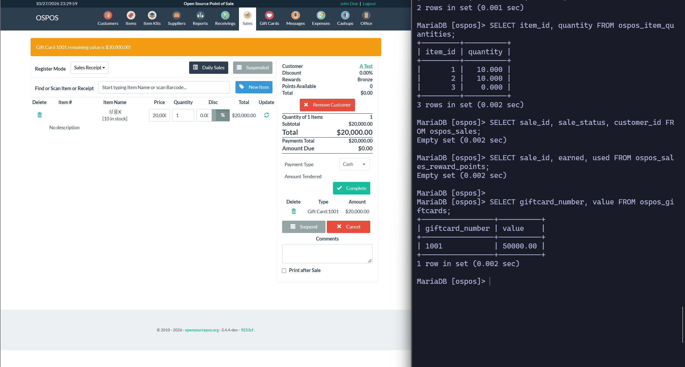
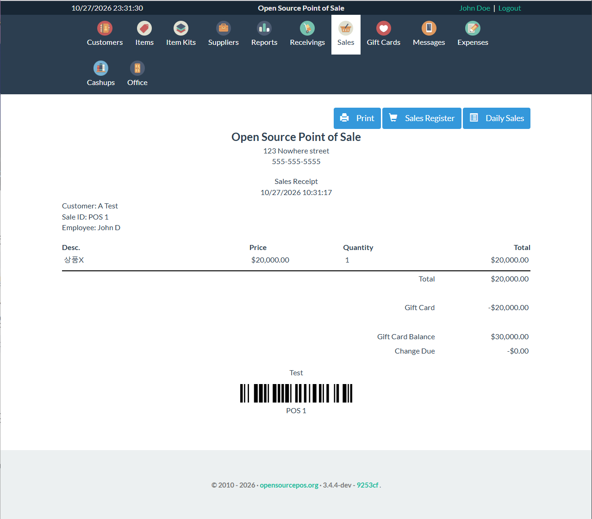
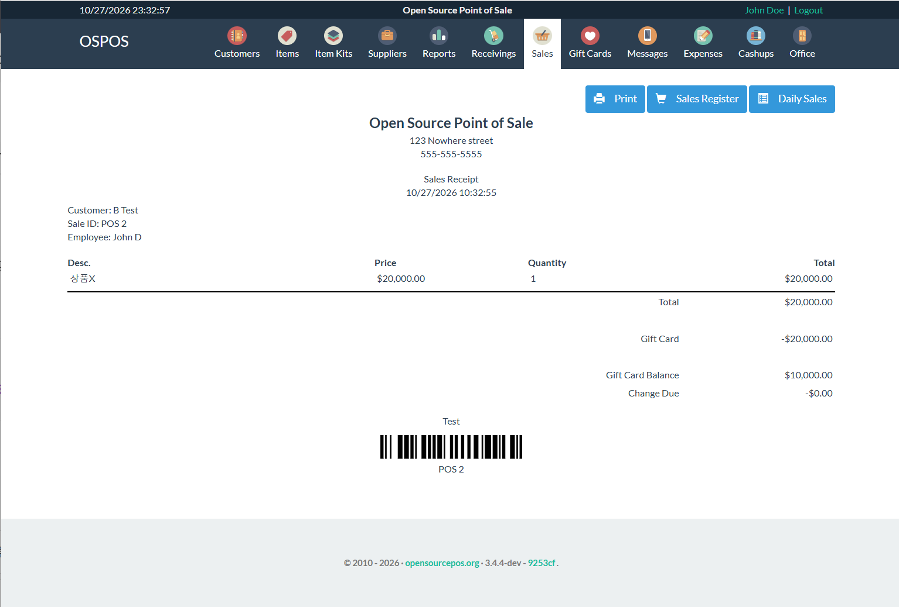
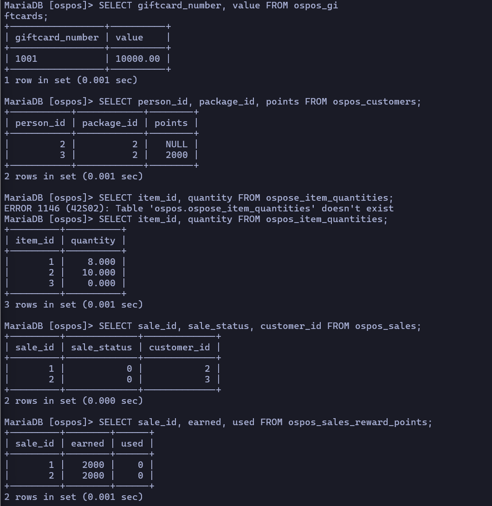
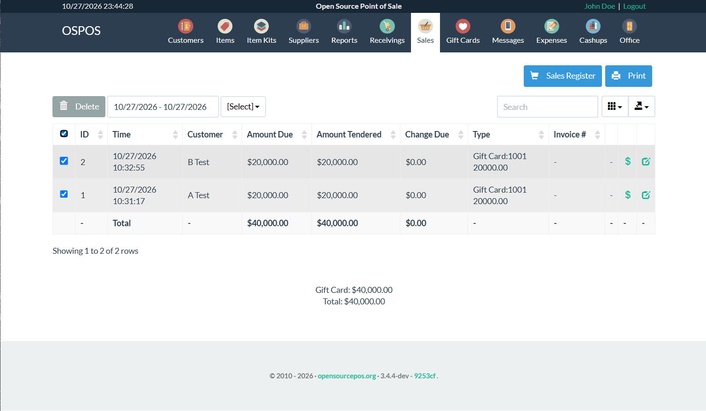
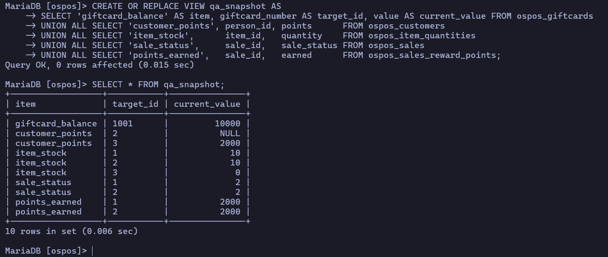

# 결함 2. 판매 취소 시 기프트카드 잔액과 적립 포인트가 돌아오지 않음

- 등급: P0
- 제보: OSPOS 저장소 기존 이슈에 재현 댓글 (원문은 문서 하단)
  - 기프트카드: #3216
  - 포인트: #4359
- 버전: OSPOS 3.4.4-dev, commit `9253cfe8`

## 요약

기프트카드로 결제한 판매를 취소(Delete)하면 **재고와 판매 상태는 원래대로 돌아온다.**
하지만 기프트카드 잔액과, 그 판매로 적립된 포인트는 돌아오지 않는다.

## 매장에 미치는 영향

- 손님이 기프트카드로 결제했다가 취소하면 결제 금액이 그대로 사라진다. 매장과 손님 사이의 환불 분쟁으로 이어진다.
- 취소된 판매의 포인트가 남아 있어, **결제 후 취소를 반복하면 포인트를 계속 쌓을 수 있다.**

## 발견 과정과 판단

### 1. 무엇을 먼저 볼지 정했다

POS에는 판매, 반품, 할인, 권한 등 볼 기능이 많다. 전부 고르게 보는 대신 **매장과 손님이 돈을 잃는 지점**을 가장 먼저 보기로 했다.
화면이 어색한 것은 불편으로 끝나지만, 취소했는데 돈이 돌아오지 않으면 실제 손해와 분쟁이 생기기 때문이다.

### 2. 코드를 읽고 가설을 세웠다

판매 취소를 처리하는 `Sale::delete()`를 읽었다. 이 함수는 재고를 되돌리고 판매 상태를 '취소'로 바꾸는 처리만 하고 있었다.
기프트카드 잔액이나 포인트를 되돌리는 코드는 보이지 않았다. 함수 안에는 개발자가 남긴 주석도 있었다.

```php
// Defect, not all item deletions will be undone?
```

그래서 **"취소하면 재고는 돌아오지만 기프트카드 잔액과 포인트는 돌아오지 않을 것"**이라는 가설을 세웠다.
코드만 보고 결함이라고 단정하지 않고, 실제로 재현되는지 확인하기로 했다.

### 3. 화면이 아니라 DB로 판정하기로 했다

영수증과 화면에는 잔액이 잘 표시되지만, 화면 값이 실제 저장값과 같다는 보장은 없다.
그래서 결제 전, 결제 중간, 결제 후, 취소 후마다 DB 값을 기록해 기대값과 비교했다.
매번 쿼리 5개를 치는 대신, 필요한 값을 한 표로 모아 보는 SQL 뷰(`qa_snapshot`)를 만들어 반복 확인했다.

### 4. 결제 중간 단계도 확인했다

기프트카드 결제를 추가하자 화면에 "잔액 30,000"이 떴다. 아직 Complete를 누르기 전이었다.
이미 DB에서 차감됐다면, 이 상태에서 결제를 취소할 경우 잔액만 사라지는 결함이 된다.
DB를 확인하니 50,000 그대로였다. 실제 차감은 Complete 때 일어났다. **결함이 아니라 안전함을 확인한 결과**로 기록했다.

### 5. 실험 하나로 두 가설을 함께 검증했다

결함 1의 비교 실험(고객 A, B)에서 두 판매를 모두 기프트카드로 결제하도록 설계했다.
그러면 같은 판매 2건을 취소하는 것만으로 기프트카드 잔액 복원과 포인트 회수를 함께 확인할 수 있다.
고객 B는 포인트가 정상 적립된 고객이라, 취소 후 포인트가 회수되는지 판단하기에 적합했다.

### 6. 기존 이슈를 확인하고 제보 방식을 정했다

OSPOS 이슈 목록에서 `giftcard`, `reward points`로 검색했다.

- **포인트**: 같은 증상의 이슈 #4359("Reward Points Not Updated on Edit/Delete Sale")가 이미 있었다. 중복 이슈를 만들지 않고, 최신 버전에서도 재현된다는 결과를 댓글로 남기기로 했다.
- **기프트카드**: 2021년 이슈 #3216은 '보류한 판매'를 취소할 때 잔액이 0이 되는 내용이다. 흐름은 다르지만 같은 영역이고, 메인테이너가 "먼저 재현해봐야 한다"고 남긴 뒤 아무도 재현하지 않은 상태였다. 완료된 판매에서도 발생한다는 재현 결과를 댓글로 남기기로 했다.
- 두 증상은 원인이 같으므로(취소할 때 결제 수단 쪽을 되돌리지 않음) 서로 참조하도록 썼다.

## 재현 절차

1. 기프트카드 1001을 만들었다. (잔액 50,000원)
2. 고객 A, B에게 상품X(20,000원)를 각각 판매하고, 둘 다 기프트카드 1001로 결제했다.
3. Sales > Daily Sales에서 두 판매를 선택해 Delete했다.
4. `qa_snapshot` 뷰로 DB를 확인했다.

## 결과

| 항목                 | 판매 후      | 취소 후    | 취소 후 기대값 | 판정     |
| -------------------- | ------------ | ---------- | -------------- | -------- |
| 판매 상태 #1, #2     | 0, 0         | 2, 2       | 2, 2           | Pass     |
| 상품X 재고           | 8            | 10         | 10             | Pass     |
| 기프트카드 1001 잔액 | 10,000       | **10,000** | 50,000         | **Fail** |
| 고객 B 포인트        | 2,000        | **2,000**  | 0              | **Fail** |
| 적립 이력            | 2,000, 2,000 | 변화 없음  | 회수 기록      | **Fail** |

재고와 상태는 돌아왔지만 기프트카드로 결제한 40,000원과 고객 B의 적립 포인트는 돌아오지 않았다. 가설과 정확히 일치한다.

결제 중간 단계. 화면은 '잔액 30,000', DB는 아직 50,000



두 판매의 영수증. 기프트카드 잔액이 30,000 → 10,000으로 차감됐다.





판매 2건 후 DB



취소한 판매 목록. 기프트카드 결제 합계 40,000원



취소 후 DB. 기프트카드 10,000, 고객 B 2,000 그대로, 재고는 10으로 복원



## 원인

취소 함수 `Sale::delete()`는 재고를 되돌리고 상태를 '취소'로 바꿀 뿐, 기프트카드 결제나 적립 포인트를 되돌리는 처리가 없다.

## 확인하지 않은 것

- 현금이나 카드처럼 다른 결제 수단으로 결제한 판매를 취소하는 경우는 확인하지 않았다.
- 반품(Return) 모드로 기프트카드 환불하는 흐름은 다른 사용자가 이미 제보했다(#4779). 중복이라 검증에서 제외했다.

## 제보 원문 (영어)

### #3216 댓글

```markdown
I can reproduce the gift card part of this on current master (3.4.4-dev, 9253cfe8, Docker)
with a **completed** sale, not only a suspended one.

Steps:

1. Gift card 1001 with value 50,000.
2. Two completed sales of 20,000 each, both paid with gift card 1001.
3. Delete both sales from Sales > Daily Sales.

|                              | after sales | after delete | expected after delete |
| ---------------------------- | ----------- | ------------ | --------------------- |
| ospos_giftcards.value (1001) | 10000       | **10000**    | 50000                 |
| item stock                   | 8           | 10           | 10                    |
| sale_status                  | 0, 0        | 2, 2         | 2, 2                  |

Stock and status are restored, but the 40,000 paid by gift card is not returned to the card.
`Sale::delete()` only reverses inventory and sets the status to CANCELED; nothing re-credits
gift card payments. Reward points earned on the deleted sales are not reversed either (#4359).
```

### #4359 댓글

```markdown
Still present on current master (3.4.4-dev, 9253cfe8, Docker).

Customer with Rewards Package "Bronze" (10%) and points = 0:

1. Completed a 20,000 sale -> points = 2000, `ospos_sales_reward_points` earned = 2000.
2. Deleted the sale from Sales > Daily Sales -> sale_status = 2.
3. Points remain **2000**, and the reward history row is unchanged.

Because `Sale::delete()` does not reverse earned points, repeating a sale and deleting it
keeps adding points to the customer. Gift card payments on deleted sales are not
re-credited either (see #3216).
```
