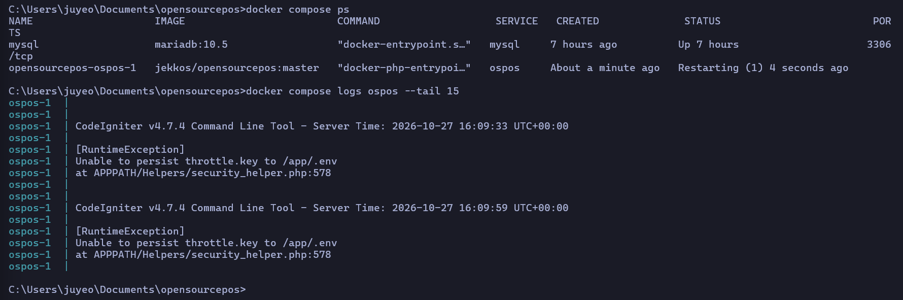
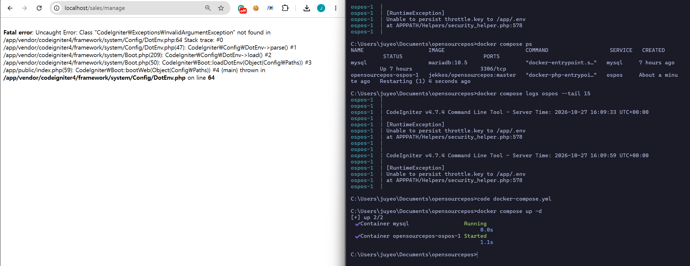

# 결함 3. 공식 안내대로 Docker 설치 시 서버가 시작되지 않음

- 등급: P1
- 제보: OSPOS 저장소 새 이슈 (원문은 문서 하단)
- 버전: OSPOS 3.4.4-dev, commit `9253cfe8`, image `jekkos/opensourcepos:master`
- 환경: Windows, Docker Desktop(WSL2)

## 요약

`docs/INSTALL.md`의 Docker 설치 안내대로 실행하면 `ospos` 컨테이너가 시작되지 않고 1분마다 재시작한다.

```
[RuntimeException]
Unable to persist throttle.key to /app/.env
at APPPATH/Helpers/security_helper.php:578
```

## 영향

처음 설치하는 사용자가 안내대로 따라 해도 제품을 실행할 수 없다. 오류 메시지만으로는 원인을 알기 어렵다.

## 발견 과정과 판단

### 1. 계획에 없던 발견이었지만 기록하기로 했다

테스트 환경을 준비하다 서버가 켜지지 않았다. 처음에는 내 환경 문제로 보고 우회만 하고 넘어갈 수도 있었다.
하지만 공식 설치 안내를 그대로 따랐는데 실패했다는 것은, **새 사용자가 제품을 처음 만나는 순간의 장애**다.
결제 기능만큼 중요하지는 않아도 제품 품질의 일부라고 보고 별도 결함으로 기록했다.

### 2. 로그에서 출발해 코드로 원인을 좁혔다

`docker compose logs`로 오류 문구를 확인하고, 그 문구가 나오는 코드(`security_helper.php`)를 찾아 읽었다.
서버가 켜질 때마다 설정 파일 `.env`를 '임시 파일을 만든 뒤 바꿔치기'하는 방식으로 다시 쓰는데,
`docker-compose.yml`은 이 파일을 호스트 PC의 파일과 직접 연결해 두고 있었다. 연결된 파일 자리로는 바꿔치기가 거부된다.

### 3. 우회하면서 생긴 두 번째 오류도 따로 기록했다

연결을 끊자 서버는 켜졌지만 이번에는 화면에 전혀 다른 오류가 떴다.
오류 문구는 '클래스를 찾을 수 없음'이었지만, 실제로는 설정 파일을 읽을 권한이 없는 문제로 보였다.
파일 소유자를 웹 서버 계정으로 바꾸자 해결됐다. **오류 메시지가 실제 원인을 가린다**는 점도 문제라고 판단해 함께 적었다.

### 4. 증거를 남기기 위해 일부러 다시 재현했다

처음 겪을 때는 해결하는 데 집중해 캡처를 남기지 못했다.
리포트에는 재현 가능한 증거가 필요하므로, 설정 파일을 공식 원본으로 되돌려 같은 증상을 다시 만들고 캡처했다.
두 번 모두 같은 증상이 나와 우연이 아니라 재현 가능한 결함임을 확인했다.

### 5. 확인한 것과 추정을 구분했다

Windows에서만 재현했다. 원인이 파일 연결 방식 자체의 제약이라 Linux에서도 같을 것으로 보이지만, 확인하지 않은 내용은 리포트에 추정이라고 명시했다.

## 재현 절차

```
git clone https://github.com/opensourcepos/opensourcepos.git
cd opensourcepos
cp .env.example .env
docker compose up -d
docker compose ps
```

`ospos`가 `Restarting (1)` 상태로 남고, `http://localhost` 접속이 거부된다.



## 원인 추정

1. `docker-compose.yml`이 호스트의 `.env` 파일 하나를 컨테이너의 `/app/.env`에 직접 연결(bind mount)한다.
2. 서버가 켜질 때 `provisionThrottleKey()`가 `.env`를 `atomicWriteFile()`로 다시 쓴다. 이 함수는 임시 파일을 만든 뒤 `rename()`으로 바꿔치기한다.
3. 연결된 파일 자리로는 바꿔치기가 거부된다. 컨테이너 안은 Linux라 코드에 있는 Windows용 대체 처리도 적용되지 않는다.
4. 키가 이미 있어도 매번 다시 쓰기 때문에, 키를 미리 넣어도 해결되지 않는다.

이 연결 방식은 #4656(2026-09-21) 무렵 도입된 것으로 보인다.

## 우회 과정에서 추가로 발견한 문제

`.env` 연결을 제거하면 컨테이너는 켜지지만, 화면에 다음 오류가 뜬다.

```
Fatal error: Uncaught Error: Class "CodeIgniter\Exceptions\InvalidArgumentException"
not found in /app/vendor/codeigniter4/framework/system/Config/DotEnv.php:64
```



`env:provision`이 root 권한으로 `.env`를 만들고 권한을 0640으로 잠가, 웹 서버(www-data)가 읽지 못하는 것으로 보인다.
다음 명령으로 해결됐다.

```
docker compose exec ospos chown www-data:www-data /app/.env
```

## 이 프로젝트에서 사용한 우회 방법

1. `docker-compose.yml`에서 `.env` 연결 5줄을 주석 처리했다.
2. 컨테이너가 켜진 뒤 위의 `chown` 명령을 직접 실행했다.

컨테이너를 다시 만들면 `.env`가 새로 생성되므로 `chown`을 다시 실행해야 한다.
매번 실행하지 않으려면 `docker-compose.yml`의 시작 명령에 추가하는 방법이 있다.

```yaml
command:
  [
    "sh",
    "-c",
    "php spark env:provision && chown www-data:www-data /app/.env && exec apache2-foreground",
  ]
```

## 확인하지 않은 것

- Linux, macOS 호스트에서는 재현하지 않았다.
- `.env` 파일의 소유자와 권한을 `ls -l`로 직접 확인하지는 않았다. 권한 문제는 `chown`으로 해결된 결과를 근거로 한 추정이다.

## 제보 원문 (영어)

```markdown
## Bug Description

Following docs/INSTALL.md ("Local install using Docker"), the `ospos` container never starts.
It restarts every minute with:

    [RuntimeException]
    Unable to persist throttle.key to /app/.env
    at APPPATH/Helpers/security_helper.php:578

## Steps to Reproduce

1. `git clone https://github.com/opensourcepos/opensourcepos.git` (commit 9253cfe8)
2. `cp .env.example .env`
3. `docker compose up -d`
4. `docker compose ps` shows `ospos` as `Restarting (1)`; http://localhost refuses the connection.

## Expected Behavior

The container starts and the login page is served.

## Likely cause

`docker-compose.yml` bind-mounts the single file `./.env` onto `/app/.env`.
On startup, `env:provision` -> `provisionThrottleKey()` always rewrites `.env` through
`atomicWriteFile()`, which writes a temp file and `rename()`s it onto the target.
Renaming onto a bind-mounted file is refused, and the Windows unlink+rename fallback
does not apply because PHP runs on Linux inside the container.
The key is rewritten even when it already exists, so pre-filling `throttle.key` does not help.

I reproduced this on Windows (Docker Desktop, WSL2) only. Since the rename restriction
comes from the mount itself, I expect the same on Linux hosts, but I have not verified it.
The bind mount appears to have been introduced around #4656.

## Additional finding with a workaround

Removing the `.env` bind mount lets the container start, but the page then shows:

    Fatal error: Uncaught Error: Class "CodeIgniter\Exceptions\InvalidArgumentException"
    not found in /app/vendor/codeigniter4/framework/system/Config/DotEnv.php:64

`env:provision` runs as root and creates `/app/.env` with mode 0640, so Apache (www-data)
likely cannot read it. `docker compose exec ospos chown www-data:www-data /app/.env` fixes it.
The fatal error also hides the real problem (an unreadable `.env`).

## Environment

- OpenSourcePOS: 3.4.4-dev, commit 9253cfe8, image jekkos/opensourcepos:master
- MariaDB 10.5 (compose default)
- Host: Windows, Docker Desktop (WSL2)
```
